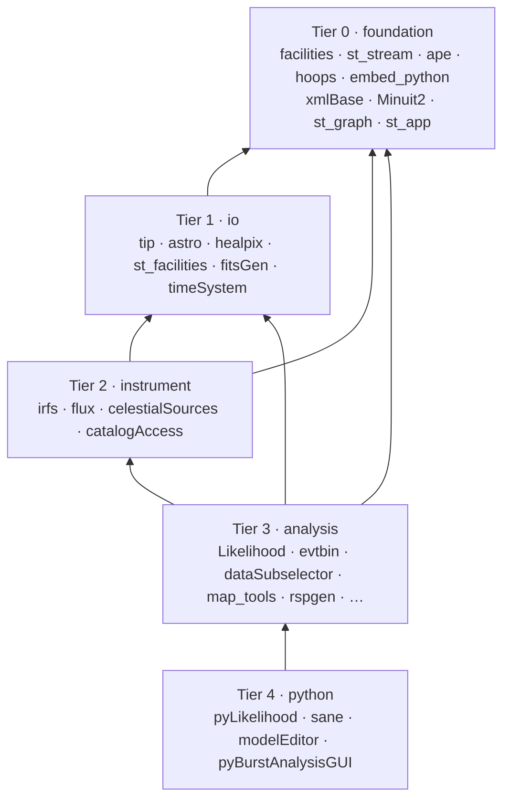
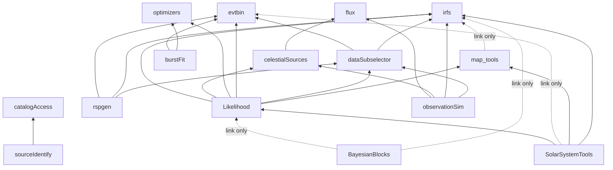

# Package Dependency Layers

This document describes how the Fermitools packages depend on each other
and on third-party libraries. Use it to find out what a change might affect
(see `used_by`), to choose where new code belongs, and to avoid creating
dependency cycles.

The dependency data comes from the `target_link_libraries` entries in each
package's `CMakeLists.txt`, excluding tests. Libraries built inside a package
are attributed to that package: `irfInterface`, `irfLoader`, `irfUtil` and
the `*Response` libraries belong to `irfs`; `eblAtten`, `genericSources`,
`microQuasar` and `EarthPhenom` to `celestialSources`; `dgaus8` to
`st_facilities`; `FermiMinuit2` to `Minuit2`. Header-only use does not
appear in this data. When precision matters, check the package's own
architecture doc, where `used_by` is based on actual `#include` usage.

*Generated against ScienceTools commit `9f7097e4` with all submodules at the
heads of their default branches.*

## Tiers

Each package belongs to one tier. A package may depend only on packages in
its own tier or in lower tiers. These tier names are the allowed values of
the `layer:` front-matter field in package architecture docs.

| Tier | `layer:` | Role | Packages |
|------|----------|------|----------|
| 0 | `foundation` | Generic infrastructure with no astronomy knowledge: environment and paths, parameter files, output streams, the application framework, XML, embedded Python, plotting, minimization engine | `facilities`, `st_stream`, `ape`, `hoops`, `embed_python`, `xmlBase`, `Minuit2`, `optimizers`, `st_graph`, `st_app` |
| 1 | `io` | FITS I/O and astronomy primitives: tables and images, sky directions and coordinates, HEALPix, shared numerical and FITS utilities | `tip`, `astro`, `healpix`, `st_facilities`, `fitsGen`, `timeSystem` |
| 2 | `instrument` | Models of the LAT and the sky: instrument response functions, source and flux models, catalog access | `irfs`, `flux`, `celestialSources`, `catalogAccess` |
| 3 | `analysis` | Science algorithms and the `gt*` tools built on them | `evtbin`, `dataSubselector`, `orbitSim`, `map_tools`, `burstFit`, `sourceIdentify`, `rspgen`, `observationSim`, `Likelihood`, `BayesianBlocks`, `SolarSystemTools`, `pyExposure` |
| 4 | `python` | Python bindings, scripting front ends and GUIs | `pyLikelihood`, `sane`, `modelEditor`, `pyBurstAnalysisGUI` |
| — | `support` | Non-code content shipped with the tools | `fermitools-fhelp` |

`optimizers` (function and parameter model classes plus minimizers) is in
tier 0. Its CMake file links `st_facilities` into the library, but only the
test program uses it, so the full table below shows that link while the
tier reflects actual use. `fitsGen` is in tier 1: it is a FITS-writing
library with no tools and only tier 0–1 dependencies. `timeSystem` (time
systems and barycentering) is also in tier 1; it ships one tool, `gtbary`.
`orbitSim` (in tier 3) is mostly a library, but it also ships `gtorbsim`.

CMake links sometimes overstate what a package uses (test-only or leftover
links). Each package's architecture doc reconciles its links with its
`#include`s; where they disagree, the package doc is authoritative.

### Allowed dependency directions

### The analysis core

This diagram shows only the edges between tier 2 and tier 3 packages. Edges
to the tier 0 and tier 1 packages are left out because nearly every package
uses `tip`, `astro`, `st_app` and `st_facilities`.

## Full dependency table

Dashed arrows in the diagrams mark link-only edges.

The *Depth* column is the length of the longest dependency chain beneath
the package. It gives a valid build order: lower depths build first.

| Depth | Package | Tier | Depends on (Fermi packages) | Used by |
|------:|---------|------|-----------------------------|---------|
| 0 | `ape` | foundation | — | hoops |
| 0 | `embed_python` | foundation | — | fitsGen (st_graph links it but does not use it) |
| 0 | `facilities` | foundation | — | Linked directly: SolarSystemTools, astro, celestialSources, dataSubselector, fitsGen, flux, irfs, st_app, tip, xmlBase. Includes it via transitive links: Likelihood, evtbin, healpix, map_tools, observationSim, orbitSim, rspgen, st_facilities, timeSystem. Python: sane |
| 0 | `Minuit2` | foundation | — | optimizers |
| 0 | `st_stream` | foundation | — | SolarSystemTools, dataSubselector, pyLikelihood, st_facilities, Likelihood, burstFit, evtbin, irfs, map_tools, observationSim, orbitSim, pyExposure, rspgen, st_app, st_graph, timeSystem |
| 0 | `fermitools-fhelp` | support | — | — |
| 0 | `modelEditor` | python | — (pure Python; needs Pmw and pyds9 at runtime) | — |
| 0 | `pyBurstAnalysisGUI` | python | No build dependencies (pure Python). At runtime it imports sane and pyLikelihood, and runs tools from dataSubselector, evtbin, Likelihood, rspgen and observationSim | — |
| 1 | `hoops` | foundation | ape | Includes it: st_app, st_graph, map_tools, evtbin, timeSystem; through st_app's headers: Likelihood, dataSubselector, observationSim (so effectively every tool); link only: sourceIdentify |
| 1 | `tip` | io | facilities | Likelihood, SolarSystemTools, astro, burstFit, catalogAccess, celestialSources, dataSubselector, evtbin, fitsGen, healpix, irfs, map_tools, observationSim, orbitSim, pyExposure, rspgen, st_facilities, timeSystem |
| 1 | `xmlBase` | foundation | facilities | Likelihood, flux, optimizers, pyExposure |
| 2 | `astro` | io | facilities, tip | BayesianBlocks (link only), Likelihood, SolarSystemTools, celestialSources, dataSubselector, evtbin, fitsGen, flux, healpix, irfs, map_tools, observationSim, pyExposure, pyLikelihood (SWIG), rspgen, st_facilities |
| 2 | `st_graph` | foundation | hoops, st_stream, Python3 (+ embed_python, link only) | burstFit, st_app; Likelihood (includes only, no symbols used) |
| 3 | `fitsGen` | io | astro, embed_python, facilities, tip | observationSim |
| 3 | `flux` | instrument | astro, facilities, xmlBase | celestialSources, observationSim |
| 3 | `healpix` | io | astro, tip | Likelihood, SolarSystemTools, evtbin, map_tools, pyLikelihood (SWIG) |
| 3 | `st_app` | foundation | facilities, hoops, st_graph, st_stream | Likelihood, SolarSystemTools, burstFit, evtbin, irfs, map_tools, observationSim, orbitSim, pyExposure, rspgen, sane, sourceIdentify, timeSystem , plus (via includes, linked transitively) dataSubselector, pyLikelihood |
| 3 | `st_facilities` | io | astro, tip | Likelihood, SolarSystemTools, celestialSources, dataSubselector, evtbin, irfs, observationSim, pyExposure, pyLikelihood (SWIG), rspgen, timeSystem; link only: BayesianBlocks, optimizers, orbitSim, sourceIdentify; tests only: burstFit, catalogAccess, sane |
| 4 | `catalogAccess` | instrument | tip (+ st_facilities, test only, though linked PUBLIC) | sourceIdentify |
| 4 | `celestialSources` | instrument | astro, facilities, flux, st_facilities, tip | Likelihood, observationSim |
| 4 | `evtbin` | analysis | astro, healpix, st_app, st_facilities, st_stream, tip | Likelihood, SolarSystemTools, burstFit, dataSubselector, rspgen, sane |
| 4 | `irfs` | instrument | astro, facilities, st_app, st_facilities, st_stream, tip, cfitsio | Likelihood, SolarSystemTools, dataSubselector (`irfUtil::EventTypeMapper` only), observationSim, pyExposure, pyLikelihood, rspgen; link only: BayesianBlocks, map_tools |
| 4 | `optimizers` | foundation | Minuit2, xmlBase (+ st_facilities, test only) | Likelihood, burstFit, pyExposure, pyLikelihood (SWIG) |
| 4 | `orbitSim` | analysis | st_app, st_stream, tip (+ st_facilities, link only) | — |
| 4 | `timeSystem` | io | st_app, st_facilities, st_stream, tip (+ facilities, hoops, transitively) | — (only the unbuilt skymaps) |
| 5 | `burstFit` | analysis | evtbin, optimizers, st_app, st_graph, st_stream, tip (+ st_facilities, link only) | — |
| 5 | `dataSubselector` | analysis | astro, evtbin, facilities, irfs (`irfUtil` only), st_facilities, tip; st_stream, st_app, hoops via evtbin | Likelihood, SolarSystemTools, observationSim, pyExposure, pyLikelihood (SWIG), rspgen; link only: sane |
| 5 | `map_tools` | analysis | astro, healpix, hoops, st_app, st_stream, tip (+ irfs, link only) | Likelihood, pyLikelihood (SWIG), SolarSystemTools (`BasicExposure` template only) |
| 5 | `sourceIdentify` | analysis | catalogAccess, st_app, tip (+ hoops, st_facilities, link only; cfitsio undeclared) | — |
| 6 | `Likelihood` | analysis | astro, celestialSources, dataSubselector, evtbin, healpix, hoops, irfs, map_tools, optimizers, st_app, st_facilities, st_graph, st_stream, tip, xmlBase | SolarSystemTools, pyExposure, pyLikelihood; link only: BayesianBlocks, sane |
| 6 | `observationSim` | analysis | astro, celestialSources, dataSubselector, fitsGen, flux, irfs, st_app, st_stream, tip | — |
| 6 | `rspgen` | analysis | astro, dataSubselector, evtbin, irfs, st_app, st_stream, tip (+ st_facilities, link only) | sane (wraps the tool; no header use) |
| 7 | `BayesianBlocks` | analysis | none used (C++ standard library and Python only); links Likelihood, astro, irfs, st_facilities but uses none of them | — |
| 7 | `pyExposure` | analysis | Likelihood, astro, dataSubselector, irfs, optimizers, st_app, st_facilities, st_stream, tip, xmlBase | — |
| 7 | `pyLikelihood` | python | Likelihood, irfs (linked); effectively also optimizers, astro, st_app, st_stream, st_facilities, dataSubselector, healpix, map_tools, CLHEP through SWIG | pyBurstAnalysisGUI; tests only: Likelihood test suite, sane; external: fermipy |
| 7 | `sane` | python | facilities (`py_facilities`) and the installed tools' par files; `test_sane` links Likelihood, dataSubselector, evtbin, rspgen, st_app, but only uses st_facilities | pyBurstAnalysisGUI, BayesianBlocks (scripts) |
| 7 | `SolarSystemTools` | analysis | Likelihood, astro, facilities, healpix, irfs, map_tools (`BasicExposure` template), st_app, st_facilities, tip; dataSubselector via Likelihood (+ evtbin, link only) | — |

## External dependencies

Third-party libraries are either built from `externals/<lib>` or found on
the system. The top-level `CMakeLists.txt` chooses between the two with
`add_or_find(...)` and the `USE_SYSTEM_<LIB>` options. Details of how each
external is integrated will go in `externals.md`.

| External | CMake target | Default source | Used by |
|----------|--------------|----------------|---------|
| cfitsio | `cfitsio::cfitsio` | system on Linux, `externals/` on macOS | tip, astro, st_facilities, irfs, celestialSources, optimizers (`Mcmc` only), timeSystem, Likelihood; flux links it but doesn't use it |
| CLHEP | `CLHEP::*` | `externals/` | astro, flux, celestialSources, irfs, evtbin, dataSubselector, optimizers, rspgen, observationSim, Likelihood, SolarSystemTools |
| GSL | `GSL::gsl` | `externals/` | st_facilities, Likelihood |
| FFTW | `FFTW::fftw3` | `externals/` | Likelihood |
| f2c | `f2c::f2c` | `externals/` | st_facilities (`dgaus8`), optimizers, Likelihood |
| healpix_cxx | `healpix_cxx::healpix_cxx` | `externals/` | astro, healpix |
| WCSlib | `WCSlib::WCSlib` | `externals/` | astro |
| CppUnit | `CppUnit::CppUnit` | `externals/` | tests in st_app, st_facilities, irfs, dataSubselector, Likelihood |
| Python 3 (≥ 3.7) + SWIG (CMake asks for ≥ 3.0.1; recipe and dev environments pin ≥ 4.1, which drops flat `Class_method` names that some old Python code still calls) | `Python3::Python` | system / conda | facilities, embed_python, st_graph, irfs (`pyIrfLoader`), Likelihood (only `gtlike`'s embedded matplotlib plotting), pyLikelihood, BayesianBlocks |
| OpenMP | `OpenMP::OpenMP_CXX` | system (required) | healpix. Likelihood links it but has no OpenMP code. (Minuit2's `minuit2_omp` option is off by default and nothing turns it on.) |
| MPI | `MPI::MPI_CXX` | system (optional; off) | Minuit2, only if `minuit2_mpi=ON`; nothing in ScienceTools enables it |
| ROOT | `ROOT::Core` | system, only with `FERMI_BUILD_ROOT=ON` (default `OFF`) | tip, celestialSources. That configuration is effectively broken: tip never dispatches to ROOT, and celestialSources' ROOT branch references factories that are never compiled. |

## Not built

- **`skymaps`** is a git submodule (`src/skymaps`) but is not listed in
  `FERMI_COMPONENTS`, so the CMake build never compiles it. It was removed
  in ScienceTools `a4e9834d` (2025-06-10), and nothing in `src/` includes it.
  It depends on `timeSystem` (io) and `irfs`-era data, so if it is ever
  revived it belongs in the `analysis` tier.
- **`pulsarDb`** and **`pulsePhase`** are commented out of
  `FERMI_COMPONENTS` and are not submodules.

## Keeping this document current

Regenerate the tables whenever you add or remove a package, or change a
`target_link_libraries` entry. If a change would make a package depend on a
package in a higher tier, rethink the change, or update the tier table here
and in the package's front matter and explain why.
